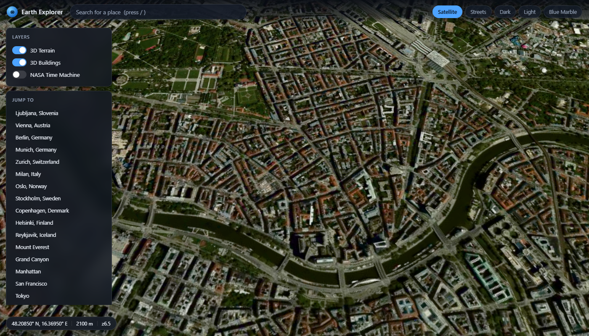

# Earth Explorer — a Google Earth clone

A browser-based 3D globe built on [CesiumJS](https://cesium.com/platform/cesiumjs/).
**No API keys, no accounts, no paid tiers** — every data source is openly accessible.



## Features

- **3D globe with satellite imagery** — Esri World Imagery, plus CARTO streets/dark/light and NASA Blue Marble.
- **Real 3D terrain** — ArcGIS WorldElevation3D (keyless), with globe lighting and atmospheric scattering.
- **3D buildings** — OpenStreetMap footprints with real `render_height` values, draped on the terrain.
- **NASA time machine** — scrub daily true-colour imagery from NASA GIBS (VIIRS, MODIS) back through the archive.
- **Place search** — Photon geocoder, no key required.
- **Street-level view** — KartaView panospheres, with sequence stepping.
- **Click anywhere** for street-level imagery, `B` for buildings, `T` for terrain, `N` for the time machine, `/` to search.

## Quick start

```bash
npm install
npm run dev
```

Then open http://127.0.0.1:5173/

```bash
npm run build      # production bundle in dist/
npm run preview    # serve the production build
npm test           # e2e smoke test against the dev server
npm run test:prod  # build, serve the bundle, and e2e-test the production build
```

`npm test` needs a dev server running (`npm run dev`) and Chrome installed.
`npm run test:prod` handles the build and server itself.

## Data sources

All keyless and CORS-friendly:

| What | Source | Endpoint |
|---|---|---|
| Satellite imagery | Esri | `server.arcgisonline.com/.../World_Imagery/MapServer` |
| Street/dark/light basemaps | CARTO | `basemaps.cartocdn.com` |
| 3D terrain | ArcGIS WorldElevation3D | `elevation3d.arcgis.com` |
| 3D buildings | OpenFreeMap (OSM) | `tiles.openfreemap.org` |
| NASA time machine | NASA GIBS | `gibs.earthdata.nasa.gov` |
| Place search | Photon | `photon.komoot.io` |
| Street-level photos | KartaView | `api.kartaview.org` |

## Notes and gotchas

- **Vector tiles stop at z14**, so 3D buildings only render at or below that zoom.
- **GIBS coverage is region- and sensor-dependent.** A sensor may have data over Australia down to z9
  but nothing over the Atlantic. GIBS answers "no coverage" with an *opaque black* tile rather than
  a 404, which would hide the basemap. `src/gibsProvider.ts` handles this by making black transparent
  (`colorToAlpha`), so the basemap shows through where the sensor has no data.
- **KartaView's effective radius is only a few hundred metres**, so `src/streetlevel.ts` probes a
  small ring of offsets around the clicked point instead of querying once.
- **Cesium's widget stylesheet is required** for the canvas to size itself; without it the globe
  collapses to the 300×150 default.

## Project layout

```
src/
  main.ts          app bootstrap, UI wiring, camera and layer controls
  globe.ts         Cesium viewer setup, basemaps, terrain, GIBS layer
  gibsProvider.ts  custom imagery provider that hides GIBS "no data" tiles
  buildings.ts     OSM vector-tile decoding and 3D building extrusion
  search.ts        Photon geocoding
  streetlevel.ts   KartaView street-level imagery
  config.ts        all endpoints, layer presets and city list
tests/
  e2e.mjs          Playwright smoke test covering every feature
  screenshot.mjs   captures the README screenshot
```

## Testing

`tests/e2e.mjs` drives a real Chrome through Playwright and asserts 13 behaviours:
canvas sizing, that satellite imagery actually rasterises pixels, the terrain
provider, building primitives, the NASA layer and its date scrubbing, place
search, camera fly-to, the street-level view, basemap switching, and a clean
console.

It runs against the dev server by default and against the built bundle with
`--prod`. The assertions deliberately avoid class names, because minification
renames them in production builds.

## Licence

MIT for the application code. The underlying data keeps its own terms:
OpenStreetMap (ODbL), Esri, NASA, and KartaView imagery all require attribution — the app
displays credits in the Cesium credit bar.
